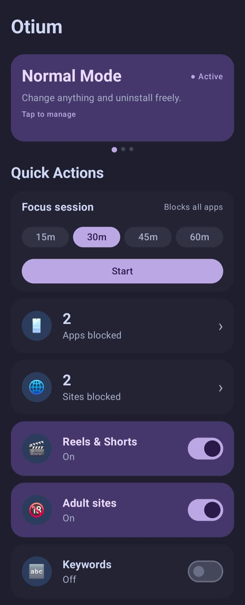
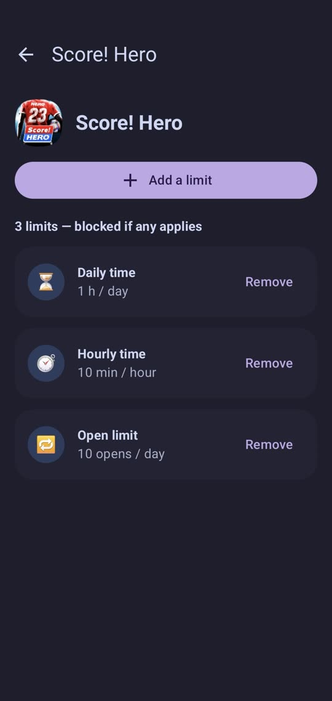
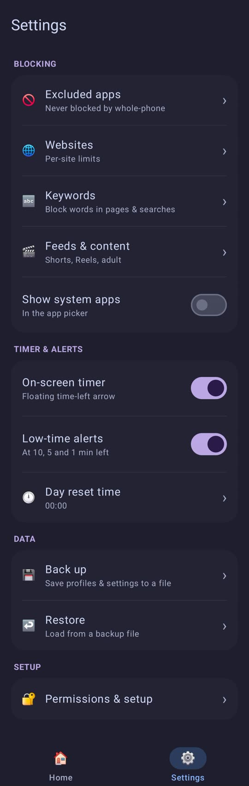

# Otium

**Otium** *(Latin)* meaning time free from obligations, used for rest, reflection and things done for their own sake.

An offline Android app and website blocker. Pick the apps and sites that eat your time, set the rules, and Otium automatically closes them when your time is up. Nothing leaves your phone: no account, no internet permission, no ads, no tracking.

  
  
  

  
  

## What it does

- **Profiles** – groups of apps and sites with their own rules. A rule can be:
  - always blocked,
  - blocked on a weekly schedule,
  - a daily or hourly time limit,
  - a limit on how many times you open the app, or
  - blocked until a date and time.
- **Per-app and per-site limits** – set daily limits for a single app or website, stacked on top of your profiles.
- **Keywords** – block pages whose address contains words you choose.
- **Shorts / Reels / adult content** – close YouTube Shorts, Instagram Reels and Facebook Reels without blocking the whole app, and block a bundled list of adult sites.
- **Focus session** – one tap on Home blocks the whole phone for set time, except your phone app, keyboard and excluded apps.
- **Time-left timer** – a small floating tab shows how much time an app has left. At 10, 5 and 1 minutes left it opens by itself on the live countdown, turns amber and gives a soft buzz.
- **Block screen** – when a rule says no, a calm full-screen page says why and sends you home.
- **Modes** – how hard it is to loosen your own rules:
  - **Normal** – change anything any time.
  - **Lock** – you must type a long random number before you can edit lock settings
  - **Strict** – set a time or schedule during which rules, Settings and uninstalling are locked. An emergency unlock exists but is slow (a long wait that doubles each time).
- **Backup, home-screen widget, dark and light themes**.

## Install

1. Download `Otium-<version>.apk` from the [Releases](../../releases) page and open it. Android will ask to allow installs from your browser or file manager.
2. Open Otium and grant the permissions below. It walks you through each one.

Needs Android 8.0 (API 26) or newer.

To get updates automatically, add this repo's URL to [Obtainium](https://github.com/ImranR98/Obtainium). It watches the Releases page and tells you when a new version is out.

## Licence

MIT. See [LICENSE](LICENSE). Free to use, change and share.
